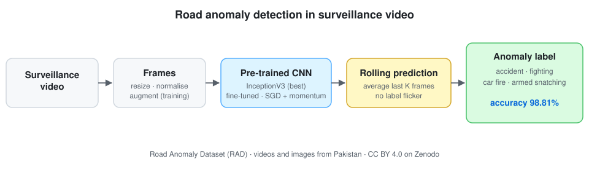

<div align="center">

# Road Anomaly Detection in Traffic Surveillance Videos
### Transfer learning with pre-trained CNNs and rolling prediction

[](https://ieeexplore.ieee.org/abstract/document/10585797)
[](https://doi.org/10.1109/ICMI60790.2024.10585797)
[](https://doi.org/10.5281/zenodo.13832363)
[](#installation)
[](LICENSE)
[](https://github.com/marif561/ICMI-Improving-Traffic-Surveillance/actions/workflows/tests.yml)

Code for **"Improving Traffic Surveillance: Deep Learning Approach for Road Anomaly Detection in Videos"**, *2024 IEEE 3rd International Conference on Computing and Machine Intelligence (ICMI)*, Mt. Pleasant, Michigan, USA, 13–14 April 2024.

Sarfaraz Natha · **Muhammad Arif** · Syed Shahryar Jamil · Fareed Ahmed Jokhio · Muslim Jameel Syed

</div>

---

## About the paper

Traffic surveillance cameras record huge amounts of video, and dangerous events on the road need to be spotted quickly. This paper presents an automatic framework that recognises **road anomalies** in surveillance video: **accidents**, **fighting**, **car fires** and **armed snatching at gunpoint**. Following a review of the literature, the approach uses **pre-trained convolutional neural networks** fine-tuned with **data augmentation**, with key hyperparameters such as the learning rate and momentum tuned. At test time, a **rolling prediction** algorithm averages predictions over consecutive frames, which stops the predicted label from flickering. The authors also introduce the **Road Anomaly Dataset (RAD)**, made of road surveillance videos and images. The best model, built on **InceptionV3**, reaches **98.81% accuracy** and outperforms the other deep-learning models compared.

<p align="center">
  
</p>

## Highlights

- 🚦 Four road anomaly types: accident · fighting · car fire · armed snatching (gunpoint)
- 🧠 Transfer learning from ImageNet-pre-trained CNNs, plus data augmentation
- 🎞️ **Rolling prediction**: frame scores are averaged over a sliding window for stable video labels
- 📦 New **Road Anomaly Dataset (RAD)**, [publicly available on Zenodo](https://doi.org/10.5281/zenodo.13832363) under CC BY 4.0
- 🏆 **InceptionV3: 98.81% accuracy**

## Dataset

The **Road Anomaly Dataset** was collected by Sarfaraz Natha at sites in Pakistan using mobile and surveillance cameras. It is published on Zenodo as *Comprehensive Dataset for Detecting Road Anomalies in Diverse Real-World Situations*, [doi:10.5281/zenodo.13832363](https://doi.org/10.5281/zenodo.13832363), under CC BY 4.0. The Zenodo release includes YOLO-format box annotations and a fifth class, **potholes**, in addition to the four anomaly types in the paper. See [`data/README.md`](data/README.md) to prepare it for this code.

## Results

| Model | Accuracy |
|---|:-:|
| **InceptionV3 + augmentation + rolling prediction** | **98.81%** |

The paper compares InceptionV3 with other pre-trained deep-learning models. Their individual scores are in the published article ([IEEE Xplore](https://ieeexplore.ieee.org/abstract/document/10585797)) and will be added to [`results/`](results/). `train.py` can run the same comparison on several backbones (`--backbone resnet50`, `vgg16`, `mobilenet_v2`, `densenet121`, …).

## How rolling prediction works

A frame-level classifier on its own can switch labels from one frame to the next, for example *accident → fighting → accident*, even when the scene hasn't changed. Rolling prediction keeps the class probabilities of the last *K* frames and labels the current frame with the class that has the highest **average** probability:

```
p̄_t = mean(p_{t-K+1}, …, p_t)      label_t = argmax(p̄_t)
```

This gives steady labels on video at almost no extra cost. See [`src/roadanomaly/rolling.py`](src/roadanomaly/rolling.py).

## Repository structure

```
.
├── configs/train.yaml       # Backbone, augmentation and optimiser settings
├── data/README.md           # Getting RAD and the expected folder layout
├── docs/figures/            # Pipeline diagram
├── results/                 # Reported results as CSV
├── scripts/                 # Backbone comparison run
├── tests/                   # Unit tests (CI on every push)
└── src/roadanomaly/
    ├── data.py              # Image-folder datasets, splits, augmentation
    ├── frames.py            # Extract frames from videos into class folders
    ├── models.py            # Pre-trained backbones with a new classification head
    ├── train.py             # Fine-tuning with SGD + momentum, evaluation
    ├── rolling.py           # Rolling (moving-average) prediction
    └── predict_video.py     # Label a video file and write an annotated copy
```

## Installation

```bash
git clone https://github.com/marif561/ICMI-Improving-Traffic-Surveillance.git
cd ICMI-Improving-Traffic-Surveillance
python -m venv .venv && source .venv/bin/activate
pip install -r requirements.txt
pip install -e .
```

## Usage

```bash
# 1. (Optional) turn labelled videos into frames, one folder per class
python -m roadanomaly.frames --videos data/videos --out data/frames --every 5

# 2. Fine-tune a pre-trained CNN (InceptionV3 by default)
python -m roadanomaly.train --data data/frames --backbone inception_v3 --out runs/inception_v3

# 3. Compare other backbones
python -m roadanomaly.train --data data/frames --backbone resnet50 --out runs/resnet50

# 4. Label a surveillance video with rolling prediction
python -m roadanomaly.predict_video --run runs/inception_v3 --input clip.mp4 --output clip_labelled.mp4 --window 32
```

Training writes the best checkpoint, accuracy, a per-class report and the confusion matrix to the run folder. `predict_video` writes an annotated video plus a CSV with per-frame and smoothed labels.

> **Note.** `src/` is a clean reference implementation of the approach described in the paper, written in PyTorch with torchvision models. The settings in [`configs/train.yaml`](configs/train.yaml) are standard fine-tuning values. Replace them with the paper's exact learning rate, momentum, augmentation and rolling-window settings where they differ.

## Responsible use

Automatic anomaly detection should support human operators, not replace them. Surveillance footage involves people's privacy, so follow local law and data-protection rules when collecting or analysing video.

## Citation

```bibtex
@inproceedings{natha2024road,
  title     = {Improving Traffic Surveillance: Deep Learning Approach for Road Anomaly Detection in Videos},
  author    = {Natha, Sarfaraz and Arif, Muhammad and Syed, Shahryar Jamil and
               Jokhio, Fareed Ahmed and Syed, Muslim Jameel},
  booktitle = {2024 IEEE 3rd International Conference on Computing and Machine Intelligence (ICMI)},
  pages     = {1--7},
  year      = {2024},
  doi       = {10.1109/ICMI60790.2024.10585797}
}

@dataset{natha2024rad,
  author    = {Natha, Sarfaraz},
  title     = {Comprehensive Dataset for Detecting Road Anomalies in Diverse Real-World Situations},
  publisher = {Zenodo},
  year      = {2024},
  doi       = {10.5281/zenodo.13832363}
}
```

## License

Code is released under the [MIT License](LICENSE). The Road Anomaly Dataset is CC BY 4.0. Credit the dataset creator when you use it.
